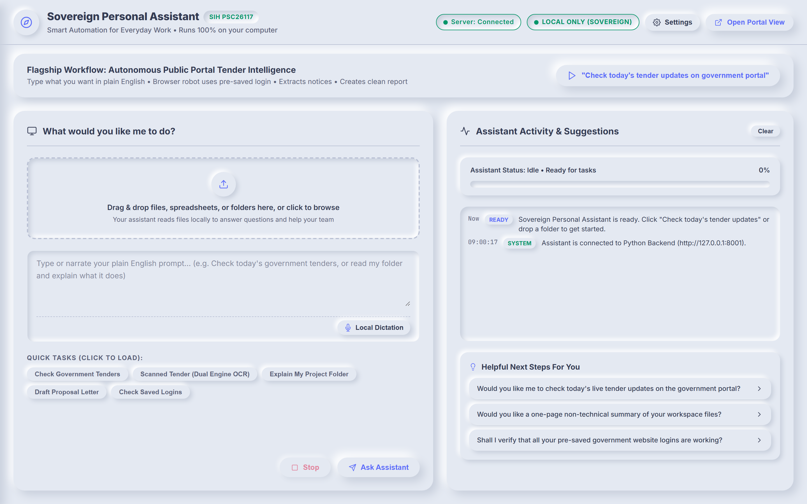

# MONOLITH: Sovereign On-Premise Agentic AI Workbench

<div align="center">



**Smart India Hackathon (SIH 2025) | Problem Statement: PSC26117**  
**Classification:** Enterprise-Grade Public Sector Sovereign AI Platform  
**Architecture:** 100% Air-Gapped Local Execution with Dual-Engine Cloud Burst Fallback  
**Compliance Standards:** Digital Personal Data Protection (DPDP) Act 2023 | CERT-In Cyber Security Guidelines

[](LICENSE)
[](https://www.python.org/)
[](https://fastapi.tiangolo.com)
[](https://ollama.ai)
[](https://pages.cloudflare.com/)

</div>

---

## 📑 Table of Contents

1. [Executive Summary](#executive-summary)
2. [Strategic Value & Problem Statement](#strategic-value--problem-statement)
3. [System Architecture](#system-architecture)
4. [Core Technical Innovations](#core-technical-innovations)
   - [1. Dual-Engine LLM Router](#1-dual-engine-llm-router)
   - [2. Instant Cookie Session Vault](#2-instant-cookie-session-vault)
   - [3. Local Vector RAG & Dual-Engine OCR](#3-local-vector-rag--dual-engine-ocr)
   - [4. Evidence & Provenance Layer](#4-evidence--provenance-layer)
   - [5. AI Verification & Anti-Hallucination Guard](#5-ai-verification--anti-hallucination-guard)
   - [6. Controlled Agent Policy & Human-in-the-Loop Gating](#6-controlled-agent-policy--human-in-the-loop-gating)
   - [7. Tamper-Evident Chained Audit Ledger](#7-tamper-evident-chained-audit-ledger)
   - [8. Prompt Injection Defense](#8-prompt-injection-defense)
   - [9. Hardware Optimization & Model Lifecycle Management](#9-hardware-optimization--model-lifecycle-management)
   - [10. Local Real-Time Dictation](#10-local-real-time-dictation)
   - [11. Reproducible Benchmark Suite](#11-reproducible-benchmark-suite)
5. [Repository Structure](#repository-structure)
6. [Cloudflare Pages Landing Page Deployment](#cloudflare-pages-landing-page-deployment)
7. [Hardware & Software Prerequisites](#hardware--software-prerequisites)
8. [Installation & Setup](#installation--setup)
9. [Configuration & Environment Variables](#configuration--environment-variables)
10. [Operational Runbook](#operational-runbook)
11. [REST API & WebSocket Reference](#rest-api--websocket-reference)
12. [SDLC Master Specification Suite](#sdlc-master-specification-suite)
13. [Security Architecture & Data Sovereignty](#security-architecture--data-sovereignty)
14. [License & Attribution](#license--attribution)

---

## Executive Summary

The **Sovereign On-Premise Agentic AI Workbench (MONOLITH)** is an air-gapped, privacy-first enterprise platform designed to automate high-friction procurement, document analysis, and administrative workflows for Indian public sector ministries, Public Sector Undertakings (PSUs), defense institutions, and state secretariats.

Modern commercial cloud AI solutions introduce severe risks of national data exfiltration, vendor lock-in, and unpredictable recurring subscription costs. Public sector officers routinely handle sensitive tender documents, confidential administrative notes, and authenticated portal credentials that cannot legally or securely leave local administrative workstations.

MONOLITH delivers a zero-recurring-cost, 100% on-premise execution model powered by local open-weight large language models (LLMs) running efficiently on commodity 8GB RAM office hardware. For high-throughput evaluation and demonstration scenarios, the platform incorporates a zero-cost Dual-Engine router that can opportunistically leverage high-speed free cloud tiers (Groq Cloud and Google Gemini) with an immediate physical air-gap kill switch.

---

## Strategic Value & Problem Statement

### Operational Bottlenecks in Public Administration

1. **Procurement Tracking Friction:** Administrative officers spend between 3.5 to 5 hours daily monitoring portals like the Government e-Marketplace (GeM) and Central Public Procurement Portal (CPPP), manually downloading multi-megabyte Request for Proposal (RFP) documents, extracting technical criteria, and creating compliance matrices.
2. **Session Timeout & OTP Exhaustion:** Government portals enforce aggressive 10 to 15 minute session idle timeouts requiring repeated SMS/email One-Time Password (OTP) verifications, breaking task execution and causing administrative latency.
3. **Hardware Constraints:** Most administrative departments operate standard workstations (Intel Core i5/i7, 8GB to 16GB RAM, integrated graphics) without dedicated cloud or enterprise GPU clusters.
4. **Data Sovereignty Compliance:** Uploading government files to offshore cloud models violates the Digital Personal Data Protection (DPDP) Act 2023 and national cyber defense directives.

### Solution Impact Metrics

| Metric | Traditional Workflow | Sovereign AI Workbench | Net Operational Benefit |
| :--- | :--- | :--- | :--- |
| **Tender Audit Duration** | 3.5 - 5.0 Hours / Day | Under 45 Seconds | Over 85% reduction in manual effort |
| **Authentication Overhead** | 6 - 8 OTP cycles / Day | 0 Repeated OTPs | Single-login local AES-256 session persistence |
| **Software & Compute Cost** | $20 - $40 / User / Month | $0.00 / Month | Built entirely on open-source and free runtimes |
| **Network Dependency** | Continuous Cloud Connectivity | Fully Air-Gapped | Zero telemetry, 100% local CPU/RAM execution |
| **Tender Deadline Drift** | ~12% Bids missed or delayed | Real-time agent monitoring | Deterministic tracking and compliance audits |

---

## System Architecture

The workbench uses a modular, decoupled architecture where the user interface, backend routing logic, local inference daemons, and browser automation drivers communicate via low-latency asynchronous protocols.

```
+-------------------------------------------------------------------------------+
|                       User Presentation & Client Layer                        |
|                                                                               |
|  +---------------------------+  +--------------------+  +------------------+  |
|  | Single-Page App (Web UI)  |  | Standalone Landing |  | Real-Time WS Feed|  |
|  | [static/index.html, JS]   |  | [cloudflare_landing|  | [/ws Telemetry]  |  |
|  +---------------------------+  +--------------------+  +------------------+  |
+---------------------------------------+---------------------------------------+
                                        | HTTP / REST / WebSocket
+---------------------------------------v---------------------------------------+
|                   FastAPI Application Server (Port 8001)                      |
|                                                                               |
|  +------------------------------------+  +---------------------------------+  |
|  | Workspace Lock Middleware (TRG-006)|  | Payload Hard Cap Guard (TRG-008)|  |
|  | Status: HTTP 423 if Locked         |  | Limit: 50 MB Upload Maximum     |  |
|  +------------------------------------+  +---------------------------------+  |
+---------------------------------------+---------------------------------------+
                                        |
         +------------------------------+------------------------------+
         |                              |                              |
+--------v--------+            +--------v--------+            +--------v--------+
|   Dual-Engine   |            | Autonomous Web  |            |   Local Vector  |
|    LLM Router   |            |  Tender Agent   |            |   RAG Engine    |
| (dual_engine.py)|            |(tender_agent.py)|            |(local_rag_en...)|
+--------+--------+            +--------+--------+            +--------+--------+
         |                              |                              |
    +----+----+                    +----+----+                    +----+----+
    |         |                    |         |                    |         |
+---v---+ +---v---+          +---v---+ +---v---+          +---v---+ +---v---+
| Local | | Cloud |          | Live  | | Mock  |          | Text  | | Dual  |
|Ollama | | Free  |          | GeM / | | GeM   |          | Chunk | | OCR   |
| Engine| | Tier  |          | CPPP  | | Portal|          | Index | | Split |
+-------+ +-------+          +-------+ +-------+          +-------+ +-------+
```

---

## Core Technical Innovations

### 1. Dual-Engine LLM Router
*File: [`dual_engine_llm.py`](file:///c:/Users/Code66/Music/Sovereign_AI_Workbench_Clean/dual_engine_llm.py)*

The DualEngineLLM client implements an adaptive routing strategy:
- **Local Sovereign Engine:** Interfaces with local Ollama daemons (`http://127.0.0.1:11434`) targeting quantized open-weight models such as `llama3.2:1b`, `llama3.2:3b`, `deepseek-r1:1.5b`, or `mistral`. Ensures complete air-gap compliance with zero packets leaving the host.
- **Turbo Cloud Engine (Evaluation Mode):** Integrates zero-cost free-tier APIs including Groq Cloud (`llama-3.3-70b-versatile` running at up to 500 tokens/second) and Google Gemini (`gemini-1.5-flash` with extensive context windows).
- **Failover & Air-Gap Kill Switch:** In the event of network disruption or when the air-gap toggle is enforced (`AIR_GAP_KILL_SWITCH_ACTIVE = True`), the engine strictly routes all prompts to the local open-weight model with automatic payload truncation and context optimization.

### 2. Instant Cookie Session Vault
*File: [`cookie_vault.py`](file:///c:/Users/Code66/Music/Sovereign_AI_Workbench_Clean/cookie_vault.py)*

Addresses government portal session drops without compromising security:
- **Cryptographic Storage:** Browser session tokens, cookies, and local authentication state are encrypted at rest using AES-256 (Fernet specification) inside `session_vault/cookie_vault.json`.
- **Automatic Browser Injection:** When `TenderAgent` launches Playwright, authenticated cookie payloads for `gem.gov.in` and `eprocure.gov.in` are decrypted in memory and injected directly into the browser context.
- **Zero OTP Re-Entry:** Officers authenticate manually once; all subsequent automated workflows inherit the live session, completely bypassing recurring SMS/email OTP prompts.

### 3. Local Vector RAG & Dual-Engine OCR
*Files: [`local_rag_engine.py`](file:///c:/Users/Code66/Music/Sovereign_AI_Workbench_Clean/local_rag_engine.py), [`document_processor.py`](file:///c:/Users/Code66/Music/Sovereign_AI_Workbench_Clean/document_processor.py)*

Provides document parsing and semantic indexing for procurement files:
- **Dual-Engine OCR Architecture:** Offloads intensive OCR tasks across a balanced client-server pipeline. The web client processes visual pages using HTML5 Canvas and Tesseract.js, while the backend leverages `pypdfium2` and `pytesseract` to split and merge large document batches without blocking the event loop.
- **Multi-Format Extraction:** Natively extracts text, structured tables, and metadata from PDF, DOCX, CSV, and scanned image formats.
- **Local Vector Indexing:** Employs lightweight TF-IDF and dense embedding representations stored in local JSON/SQLite stores, executing vector cosine similarity ranking without requiring external vector database infrastructure.

### 4. Evidence & Provenance Layer
*File: [`provenance_engine.py`](file:///c:/Users/Code66/Music/Sovereign_AI_Workbench_Clean/provenance_engine.py)*

Provides complete chain-of-evidence traceability for every AI-generated conclusion:
- **Granular Evidence Citations:** Associates every claim with exact document identifiers, verified page numbers, section clauses, and character offset boundaries.
- **Cryptographic Passage Hashing:** Computes SHA-256 digests for every extracted snippet to prevent silent context mutation.
- **Evidence Sufficiency Check:** Quantifies the proportion of user inquiry concepts grounded in indexed documents. If grounding coverage is below 30%, the system explicitly abstains rather than inventing speculative claims.

### 5. AI Verification & Anti-Hallucination Guard
*File: [`verification_engine.py`](file:///c:/Users/Code66/Music/Sovereign_AI_Workbench_Clean/verification_engine.py)*

Executes a deterministic claim-checking pipeline prior to presenting outputs to officers:
- **Concordance Evaluation:** Classifies responses into explicit categories: `SUPPORTED`, `PARTIALLY_SUPPORTED`, `UNSUPPORTED`, `CONTRADICTED`, `INSUFFICIENT_EVIDENCE`, and `REQUIRES_HUMAN_REVIEW`.
- **Numeric Fact Checker:** Extracts high-consequence procurement entities (EMD figures, currency totals, percentages, deadlines) and detects discrepancies against source documentation before display.
- **Zero Fabricated Probabilities:** Rejects uncalibrated statistical pseudo-probabilities, preferring transparent claim-matching and explicit abstention.

### 6. Controlled Agent Policy & Human-in-the-Loop Gating
*File: [`governed_agent.py`](file:///c:/Users/Code66/Music/Sovereign_AI_Workbench_Clean/governed_agent.py)*

Enforces deterministic risk-tiered governance over autonomous browser and system actions:
- **Deterministic Risk Tiers:**
  - **LOW RISK (Auto-Executed):** Read-only portal searches, document summaries, indexing.
  - **MEDIUM RISK (Logged):** Generating local draft responses, exporting reports.
  - **HIGH RISK (Gated):** Submitting bids, portal writes, deleting records, external cloud offloading.
- **Human-in-the-Loop Gate:** High-impact operations immediately pause agent execution and present an authorization modal displaying the intended action, target URL, and payload. Execution proceeds only upon explicit officer approval.

### 7. Tamper-Evident Chained Audit Ledger
*File: [`audit_ledger.py`](file:///c:/Users/Code66/Music/Sovereign_AI_Workbench_Clean/audit_ledger.py)*

Provides cryptographic non-repudiation and auditable records stored in `output/.vault/audit_trail.jsonl`:
- **SHA-256 Block Chaining:** Each event record incorporates the SHA-256 hash of the preceding event, forming an immutable ledger.
- **Cryptographic Chain Verification:** The `GET /api/audit/verify` endpoint verifies the integrity of the audit blockchain from genesis to head.
- **Zero Secret Leakage:** Automatically redacts passwords, session cookies, auth tokens, and API credentials from logged event details.

### 8. Prompt Injection & Untrusted Document Defense
*File: [`injection_guard.py`](file:///c:/Users/Code66/Music/Sovereign_AI_Workbench_Clean/injection_guard.py)*

Treats all external documents, PDFs, OCR results, and scraped web content as untrusted input:
- **Injection Sanitization:** Neutralizes jailbreaks, directive overrides (`"Ignore previous instructions"`), and exfiltration vectors.
- **Structural Demarcation:** Formats prompts with strict XML/markdown boundaries separating system policy from passive document context.

### 9. Hardware Optimization & Model Lifecycle Management
*File: [`ollama_manager.py`](file:///c:/Users/Code66/Music/Sovereign_AI_Workbench_Clean/ollama_manager.py)*

Provides programmatic governance over host machine compute resources:
- **Hardware Telemetry:** Senses available host RAM, CPU topology, and GPU presence. Recommends optimal model quantization (e.g., 1B/3B models for 8GB RAM workstations).
- **Lifecycle Control:** Programmatically initiates the `ollama serve` process, monitors model download streams, switches active models in RAM, and unloads dormant models to conserve host memory.

### 10. Local Real-Time Dictation (ASR & VAD)
*File: [`dictation_engine.py`](file:///c:/Users/Code66/Music/Sovereign_AI_Workbench_Clean/dictation_engine.py)*

Provides native, 100% on-premise streaming speech-to-text directly into the prompt workflow:
- **Zero Cloud Leakage:** All microphone audio is captured and transcribed strictly on local CPU; no external speech APIs or telemetry are invoked.
- **Interchangeable Engine Abstraction:** Supports lightweight Kaldi-based **Vosk** and real-time neural ONNX **Moonshine**.
- **Energy VAD:** Suppresses ASR compute during silence and detects utterance boundaries to conserve CPU.
- **WebSocket Streaming:** Streams 16kHz mono PCM chunks with continuous partial and final text insertion directly into the UI.

### 11. Reproducible Benchmark Suite
*File: [`benchmark_engine.py`](file:///c:/Users/Code66/Music/Sovereign_AI_Workbench_Clean/benchmark_engine.py)*

Provides a standardized evaluation suite measuring actual hardware capabilities:
- Measures evidence extraction latency, verification claim evaluation throughput, numeric contradiction recall, and injection defense latency.
- Accessible via REST endpoint `GET /api/system/benchmark`.

---

## Repository Structure

```
.
|-- Launch_Sovereign_Workbench.bat    # Windows one-click environment launcher
|-- server.py                         # Core FastAPI server and REST/WS API handlers
|-- dual_engine_llm.py                # Dual-Engine LLM router (Local + Cloud Burst)
|-- local_rag_engine.py               # Vector search, document chunking, and RAG
|-- document_processor.py             # OCR engine, PDF rasterizer, table extractor
|-- tender_agent.py                   # Autonomous procurement browser automation
|-- cookie_vault.py                   # Encrypted AES-256 portal session persistence
|-- profile_manager.py                # Workspace security, lock state, recovery
|-- ollama_manager.py                 # Local Ollama daemon and model management
|-- audit_ledger.py                   # Cryptographic SHA-256 tamper-evident ledger
|-- verification_engine.py            # Claim verification & anti-hallucination engine
|-- provenance_engine.py              # Evidence extraction and attribution tracker
|-- injection_guard.py                # Prompt injection and adversarial filter
|-- dictation_engine.py               # Local offline speech-to-text engine
|-- benchmark_engine.py               # Automated performance & accuracy benchmark
|-- requirements.txt                  # Python dependencies
|
|-- cloudflare_landing/               # 🚀 Standalone Cloudflare Pages landing package
|   |-- index.html                    # Decoupled standalone landing page
|   |-- style.css                     # Obsidian & Titanium dark mode theme
|   |-- app.js                        # Client-side WebGL shaders & interactive simulators
|   |-- _headers                      # Cloudflare Pages security & immutable cache rules
|   |-- _redirects                    # Cloudflare Pages SPA fallback routing
|   `-- assets/                       # Self-contained fonts, Three.js, and card assets
|
|-- landing/                          # Source landing page served locally by server.py
|   |-- index.html
|   |-- style.css
|   |-- app.js
|   `-- assets/
|
|-- static/                           # Workbench application frontend
|   |-- index.html                    # Main single-page application interface
|   |-- app.js                        # Frontend UI controllers and WebSocket clients
|   `-- style.css                     # Neumorphic CSS design system
|
|-- output/                           # System outputs, uploads, and specifications
|   |-- SDLC_Master_Specification.md  # Comprehensive 13-document SDLC master suite
|   |-- 01_BRD.md to 14_Settings.md   # Individual formal engineering specifications
|   `-- .vault/                       # Encrypted profiles and audit trail
|
`-- session_vault/                    # Encrypted local credential storage
    `-- cookie_vault.json             # AES-256 encrypted session tokens
```

---

## 🚀 Cloudflare Pages Landing Page Deployment

The [`cloudflare_landing/`](file:///c:/Users/Code66/Music/Sovereign_AI_Workbench_Clean/cloudflare_landing) folder is completely self-contained with **zero backend dependencies**, local fonts, bundled Three.js runtime, security headers, and direct links to the official repository.

### Option 1: Direct Drag & Drop (Instant)
1. Go to the [Cloudflare Dashboard](https://dash.cloudflare.com/) &rarr; **Workers & Pages** &rarr; **Overview**.
2. Click **Create application** &rarr; select the **Pages** tab.
3. Choose **Upload assets**.
4. Set a project name (e.g., `monolith-landing`).
5. Drag and drop the `cloudflare_landing/` directory into the upload zone.
6. Click **Deploy site**.

### Option 2: Connect to Git Repository
1. In Cloudflare Pages, choose **Connect to Git** &rarr; select `Gulshan-Singh-gs/monolith`.
2. Configure build settings:
   - **Framework preset:** `None`
   - **Build command:** *(leave blank)*
   - **Build output directory:** `cloudflare_landing`
3. Click **Save and Deploy**. Cloudflare will automatically build and publish updates on every push.

---

## Hardware & Software Prerequisites

### Hardware Specifications

| Component | Minimum Specification | Recommended Specification |
| :--- | :--- | :--- |
| **Processor** | 4-Core Intel Core i5 (8th Gen) or AMD Ryzen 5 | 8-Core Intel Core i7 / AMD Ryzen 7 |
| **Memory** | 8 GB RAM (Runs 1B / 3B Quantized Models) | 16 GB - 32 GB RAM (Runs 7B / 8B Models) |
| **Storage** | 10 GB available SSD space | 50 GB available NVMe SSD space |
| **Graphics** | Integrated Intel UHD / Iris Xe Graphics | Dedicated NVIDIA GPU (CUDA acceleration optional) |
| **Architecture** | x86_64 / ARM64 with AVX2 instruction support | x86_64 / ARM64 with AVX2 and CUDA support |

### Software Prerequisites

- **Operating System:** Windows 10/11 (64-bit), Ubuntu 22.04+ LTS, or macOS 13+
- **Python Runtime:** Python 3.10, 3.11, or 3.12
- **Local AI Daemon:** Ollama (version 0.3.0 or higher)
- **Web Browser:** Chromium, Google Chrome, or Microsoft Edge

---

## Installation & Setup

### 1. Clone Repository

```bash
git clone https://github.com/Gulshan-Singh-gs/monolith.git
cd monolith
```

### 2. Python Environment Setup

```bash
# Windows (PowerShell)
python -m venv venv
.\venv\Scripts\Activate.ps1

# Linux / macOS
python3 -m venv venv
source venv/bin/activate
```

Install Python dependencies:

```bash
pip install --upgrade pip
pip install -r requirements.txt
playwright install chromium
```

### 3. Local AI Engine (Ollama) Setup

1. Install Ollama from [ollama.ai](https://ollama.ai) or via terminal:
   ```bash
   # Linux
   curl -fsSL https://ollama.com/install.sh | sh
   ```
2. Start the Ollama background service:
   ```bash
   ollama serve
   ```
3. Pull the recommended local model:
   ```bash
   # 8GB RAM configuration
   ollama pull llama3.2:1b

   # 16GB RAM configuration (Optional)
   ollama pull llama3.2:3b
   ```

---

## Configuration & Environment Variables

Create a `.env` file in the project root to customize runtime parameters:

```ini
# Server Configuration
HOST=127.0.0.1
PORT=8001
WORKBENCH_ENV=production

# Dual-Engine LLM Configuration
# Options: 'local' (Strict Air-Gap), 'auto' (Adaptive), 'groq', 'gemini'
PREFERRED_ENGINE=local
LOCAL_MODEL=llama3.2:1b
OLLAMA_URL=http://127.0.0.1:11434

# Optional Cloud Burst Free Tier Credentials (Evaluation / Demo Mode)
GROQ_API_KEY=gsk_your_free_groq_key_here
GEMINI_API_KEY=AIzaSy_your_free_gemini_key_here

# Security Constraints
MAX_UPLOAD_BYTES=52428800
AIR_GAP_KILL_SWITCH=false
```

---

## Operational Runbook

### Starting the Workbench

#### Method A: Windows One-Click Launcher
Double-click `Launch_Sovereign_Workbench.bat` or run:
```cmd
Launch_Sovereign_Workbench.bat
```

#### Method B: Manual Command Line
```bash
python server.py
```

### Accessing Interfaces

- **Interactive Workbench UI:** [`http://127.0.0.1:8001/`](http://127.0.0.1:8001/)
- **Landing Page (Local):** [`http://127.0.0.1:8001/landing/`](http://127.0.0.1:8001/landing/)
- **Swagger API Documentation:** [`http://127.0.0.1:8001/docs`](http://127.0.0.1:8001/docs)
- **ReDoc Specification:** [`http://127.0.0.1:8001/redoc`](http://127.0.0.1:8001/redoc)

---

## REST API & WebSocket Reference

### System & Telemetry Endpoints

| Method | Endpoint | Description |
| :--- | :--- | :--- |
| `GET` | `/` | Serves the main workbench single-page application. |
| `GET` | `/api/status` | Returns workbench health, engine status, and vault counts. |
| `GET` | `/api/hardware` | Returns host CPU, physical RAM, and GPU detection telemetry. |
| `WS` | `/ws` | Real-time WebSocket connection for live agent updates and OCR telemetry. |
| `WS` | `/ws/dictation` | Streaming WebSocket for real-time local speech-to-text. |

### Procurement Agent Endpoints

| Method | Endpoint | Description |
| :--- | :--- | :--- |
| `POST` | `/api/agent/run-task` | Initiates autonomous tender search and compliance matrix extraction. |
| `POST` | `/api/agent/stop` | Terminates active Playwright browser routines and releases system locks. |
| `GET` | `/mock-gem-portal` | Renders the internal offline GeM procurement simulation environment. |

### Document Intelligence & Local RAG

| Method | Endpoint | Description |
| :--- | :--- | :--- |
| `POST` | `/api/rag/upload` | Ingests PDF, DOCX, or CSV files into the secure `output/uploads/` directory. |
| `POST` | `/api/rag/analyze` | Triggers document text extraction, table parsing, and vector indexing. |
| `POST` | `/api/rag/query` | Executes semantic vector search against indexed local files. |
| `POST` | `/api/ocr/split` | Splits large multi-page PDF jobs into parallel processing batches. |
| `POST` | `/api/ocr/batch` | Executes server-side OCR processing on a specified page batch. |
| `POST` | `/api/ocr/complete` | Assembles extracted page text into a unified searchable document index. |

### Local Model Management (Ollama)

| Method | Endpoint | Description |
| :--- | :--- | :--- |
| `GET` | `/api/ollama/models` | Lists all local models currently stored on the host machine. |
| `POST` | `/api/ollama/pull` | Starts an asynchronous stream to download a new open-weight model. |
| `GET` | `/api/ollama/pull-status`| Polls progress for active model download streams. |
| `POST` | `/api/ollama/switch` | Replaces the active model residing in host RAM. |
| `POST` | `/api/ollama/unload` | Ejects models from memory to free host RAM for other tasks. |
| `DELETE`| `/api/ollama/delete` | Removes a downloaded model from local storage. |

### Workspace Security & Audit Ledger

| Method | Endpoint | Description |
| :--- | :--- | :--- |
| `GET` | `/api/profile` | Fetches active profile settings, lock state, and protection status. |
| `POST` | `/api/profile/lock` | Activates global workspace lock (enforces HTTP 423 on protected APIs). |
| `POST` | `/api/profile/unlock` | Authenticates master password to disengage workspace lock. |
| `GET` | `/api/audit/trail` | Fetches cryptographic audit events. |
| `GET` | `/api/audit/verify` | Verifies SHA-256 block chain integrity from genesis to head. |

---

## SDLC Master Specification Suite

All formal engineering artifacts are versioned in the [`output/`](file:///c:/Users/Code66/Music/Sovereign_AI_Workbench_Clean/output) directory:

| ID | Document Name | Purpose & Coverage |
| :--- | :--- | :--- |
| 01 | [`01_BRD.md`](file:///c:/Users/Code66/Music/Sovereign_AI_Workbench_Clean/output/01_BRD.md) | Business Requirements Document: Problem analysis, market sizing, ROI models. |
| 02 | [`02_PRD.md`](file:///c:/Users/Code66/Music/Sovereign_AI_Workbench_Clean/output/02_PRD.md) | Product Requirements Document: Functional requirements, user personas. |
| 03 | [`03_User_Journeys.md`](file:///c:/Users/Code66/Music/Sovereign_AI_Workbench_Clean/output/03_User_Journeys.md) | Step-by-step user journey maps for administrative desk officers. |
| 04 | [`04_UI_UX_Specs.md`](file:///c:/Users/Code66/Music/Sovereign_AI_Workbench_Clean/output/04_UI_UX_Specs.md) | Interface guidelines, design tokens, layout hierarchy. |
| 05 | [`05_Architecture_Diagram.md`](file:///c:/Users/Code66/Music/Sovereign_AI_Workbench_Clean/output/05_Architecture_Diagram.md) | Detailed architectural schematics and data flow diagrams. |
| 06 | [`06_TRD.md`](file:///c:/Users/Code66/Music/Sovereign_AI_Workbench_Clean/output/06_TRD.md) | Technical Requirements Document: Latency budgets, memory bounds. |
| 07 | [`07_Detailed_Design.md`](file:///c:/Users/Code66/Music/Sovereign_AI_Workbench_Clean/output/07_Detailed_Design.md) | Class models, database schemas, and cryptographic definitions. |
| 08 | [`08_API_Contract_OpenAPI.md`](file:///c:/Users/Code66/Music/Sovereign_AI_Workbench_Clean/output/08_API_Contract_OpenAPI.md) | Complete OpenAPI 3.1 specification for all REST and WebSocket routes. |
| 09 | [`09_Implementation_Plan.md`](file:///c:/Users/Code66/Music/Sovereign_AI_Workbench_Clean/output/09_Implementation_Plan.md) | Milestones, sprint schedules, and development phase breakdowns. |
| 10 | [`10_Test_Strategy.md`](file:///c:/Users/Code66/Music/Sovereign_AI_Workbench_Clean/output/10_Test_Strategy.md) | Quality assurance strategy, unit test coverage, and security testing. |
| 11 | [`11_ADRs.md`](file:///c:/Users/Code66/Music/Sovereign_AI_Workbench_Clean/output/11_ADRs.md) | Architectural Decision Records: Framework, engine, and crypto choices. |
| 12 | [`12_Security_Compliance.md`](file:///c:/Users/Code66/Music/Sovereign_AI_Workbench_Clean/output/12_Security_Compliance.md) | Compliance audits for DPDP Act 2023, CERT-In, and air-gap guidelines. |
| 13 | [`13_Runbook_Deployment.md`](file:///c:/Users/Code66/Music/Sovereign_AI_Workbench_Clean/output/13_Runbook_Deployment.md) | Production installation, air-gapped provisioning, and operational runbook. |
| 14 | [`14_Settings_Profile_Ollama_Spec.md`](file:///c:/Users/Code66/Music/Sovereign_AI_Workbench_Clean/output/14_Settings_Profile_Ollama_Spec.md) | Host resource governor, profile management, and model quantization spec. |
| **Suite** | [`SDLC_Master_Specification.md`](file:///c:/Users/Code66/Music/Sovereign_AI_Workbench_Clean/output/SDLC_Master_Specification.md) | Master single-file compilation of all 14 engineering specifications. |

---

## Security Architecture & Data Sovereignty

### Regulatory & Legal Compliance

- **Digital Personal Data Protection (DPDP) Act 2023:** Citizen records, tender bids, and officer identifiers never transit through overseas cloud servers.
- **CERT-In Cyber Security Guidelines:** Local encryption at rest, memory sanitation, least-privilege system process execution, and strict air-gap boundary isolation.

### Technical Safeguards

1. **Air-Gap Boundary Isolation:** When set to sovereign execution mode, all socket communication is restricted to `127.0.0.1`. No outbound network packets are emitted.
2. **Payload Protection (TRG-008):** A strict 50 MB hard limit is enforced on all file ingestion endpoints (`MAX_UPLOAD_BYTES = 52428800`) to prevent memory exhaustion and denial-of-service attacks.
3. **Cryptographic Storage:** `CookieVault` encrypts credentials using AES-256 with key derivation tied to the host system profile.
4. **Physical Token Recovery:** Administrative recovery is decoupled from cloud identity providers, relying entirely on local cryptographic proof and physical media tokens.

---

## License & Attribution

Distributed under the **MIT License**.

Engineered for the **Smart India Hackathon (SIH 2025)** addressing **Problem Statement PSC26117** in alignment with national initiatives for technological sovereignty and self-reliance (*Atmanirbhar Bharat*).
