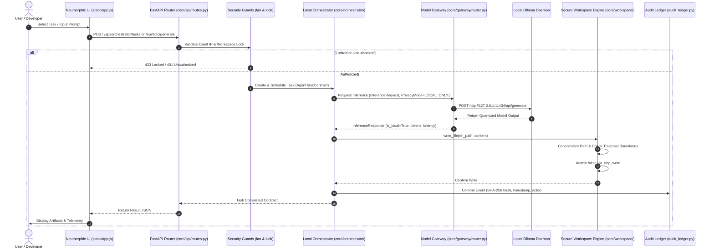
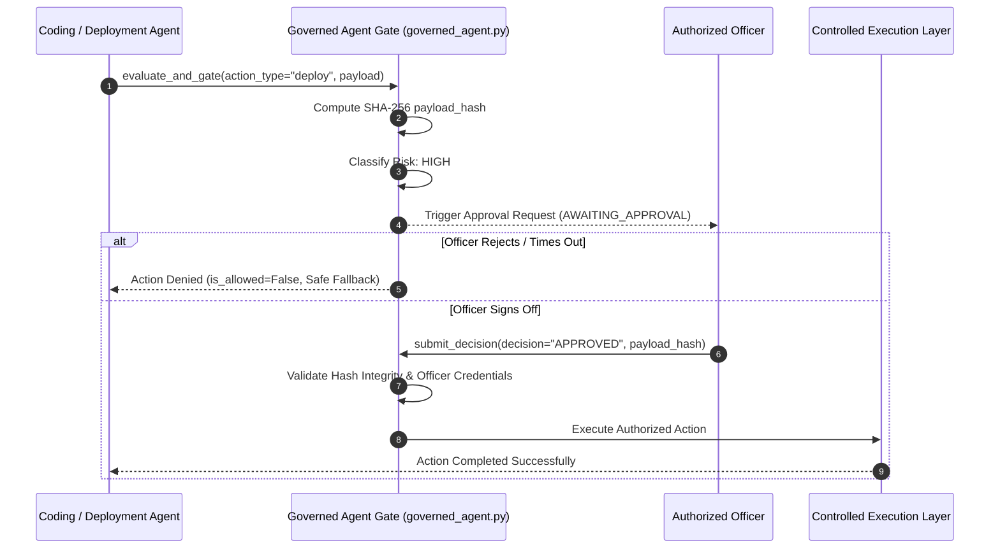

# Component Interactions: Sovereign On-Premise Agentic AI Workbench

**Scope**: Production-verified inter-module communication patterns and event contracts.

---

## 1. Interaction Diagram: Orchestrator to Workspace & Model Gateway

---

## 2. HITL Governance & Cryptographic Approval Gate

